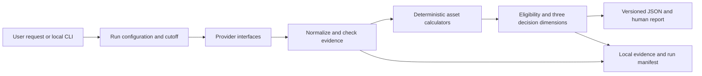

# Architecture proposal

Use a local Python workflow that reuses upstream calculation scripts through explicit adapters. Codex handles intent, evidence collection where permitted, and explanation. A deterministic pipeline owns validation, financial calculations, eligibility, and ranking. A structured result remains usable without an agent.

## Proposed boundaries

| Component | Responsibility |
|---|---|
| Entry points | A future fork-local CLI plus thin `.agents/skills/` wrappers for screening, dossier, themes and portfolio. The wrappers reference one canonical workflow definition. Explicit tool availability and evidence handoffs replace assumptions about Claude WebSearch or plugins. |
| Provider ports | Separate narrow interfaces for instrument universe, prices/actions, fundamentals/filings, distributions, FX, ETF holdings, and crypto market data. Inputs include instrument identity, date range, cutoff, and adjustment/currency requirements. Responses describe entitlement, rate limiting, completeness, staleness and errors. |
| Adapters | Start with fixture providers and an FMP adapter over existing tested clients or CLI output. Apply SEC and issuer evidence via dedicated adapters. Implement SGX and crypto behind different capability profiles. Reject silent fallback between datasets with incompatible coverage or adjustment semantics. |
| Evidence and normalization | Use listing identity with venue (MIC), local symbol and validity ranges, plus stable issuer/instrument identifiers where available. Keep exchange timezone, currency, amount scale, share basis, effective date, published/available times, retrieval time, provider refs and revision. Crypto identities carry venue, pair, quote and chain/contract when relevant. |
| Research and decisions | Pass normalized inputs to upstream subprocess adapters with pinned contracts and explicit JSON IO. Add domain-specific methods only when justified. Eligibility gates run before scoring. Emit three dimensions with explanations, method version, source references, flags and blocked reasons. |
| Persistence | Begin with local versioned JSON/JSONL and manifests. Add SQLite only if repeated joins, snapshot history or indexing warrant it. Keep run outputs in an explicit private root outside the checkout. Record data hashes, configuration hash, code revision and clock. Make raw payload retention depend on rights. |
| Trust and permissions | Restrict live access to approved read-only endpoints. Provider credentials stay in authorized secret injection. Broker account data is an optional offline import. External content cannot grant permissions, invoke shell, alter eligibility or change portfolio state. Validate paths and schemas and redact errors and exports. |

## Time and decision model

Preserve upstream `data_provenance` and `evaluation_coverage` alongside a fork-specific record envelope. Distinguish observation date, market session, publication or first-known time, retrieval time and revision. Historical runs reject values unavailable at their cutoff. Preserve FX pair, rate and timestamp, quantify coverage, and reconcile reported versus normalized values. Respect local closing sessions and keep adjusted research prices separate from executable raw quotes.

Each output declares its market, cohort, evaluation time and method. Attractiveness covers value and business quality, risk covers loss drivers and liquidity, and confidence covers evidence quality and breadth. A missing noncritical field may lower confidence under its policy. Missing or unresolved critical fields, unidentified instruments, or misrepresented universe coverage block final ranking. Reports show assumptions and sensitivity without converting them into promises.

The initial valuation policy should select methods by business model and available evidence. For an operating company, use a base, downside and upside case with explicit revenue, margin, reinvestment and dilution assumptions. Reconcile enterprise and equity value before comparing with the traded share price. Use a reverse valuation to show what the price implies when the inputs support it. Use sector-specific comparables for financials, and reconcile REIT distribution coverage to issuer-reported cash adjustments. Estimate ranges and model assumptions are labelled separately from observed values, with source and method versions for both. Valuation models that lack valid inputs remain unavailable.

## Upstream integration

Proposed fork paths are `investment_intelligence/`, `tests/custom/`, `config/custom/` and `.agents/skills/`. These are proposals only. Preserve upstream entry points, artifacts, lock policy, and supported runtimes. Prefer stable script boundaries over importing skill-local modules with ambiguous names. Keep custom fixtures and gates independent from upstream catalogs. Check upstream contract diffs, docs and package drift before each fork upgrade. Preserve the MIT notice and track separately licensed records by provider and use.
